# 02. 현재 구조 (AS-IS)

> **요약**: Python 패키지 `onprem_atlas`(kit/)가 xlsx 파싱·SQLite 저장·분류·구성도·API를 맡고, React/Carbon 콘솔(src/)이 API를 그린다. 약 4,800줄.
> **근거 소스**: `kit/src/onprem_atlas/**`, `src/**`, `Makefile`, `vite.config.ts`
> **관련 페이지**: [10](10-data-model.md), [20](20-api-contract.md), [33](33-ui-pages-and-menu.md)

## 데이터 흐름

```mermaid
flowchart LR
  X[ESM .xlsx] -->|POST /api/imports/preview| P[ingest: 헤더 탐지·정규화·검증]
  P --> C{components?}
  C -->|web/was/db| CP[components.parse_components]
  C -->|servers/equipment/security| AP[ingest.parse_xlsx + source_defaults]
  CP & AP --> PI[(pending_imports)]
  PI -->|POST /api/imports/commit| S[store.import_parsed: 새 실행 = 전체 스냅샷]
  S --> CL[classify.classify_run: 업무 분류]
  CL --> DB[(SQLite: sync_runs, run_assets, run_components, ...)]
  DB --> API[web: /api/summary, projects, assets, components, diff, diagram]
  API --> UI[React 콘솔]
  DB --> DG[diagram.render: 레이아웃 JSON + draw.io XML]
  DG --> API
```

## 모듈 지도 (Python, `kit/src/onprem_atlas/`)

| 파일 | 줄 | 역할 | 포팅 |
|---|---|---|---|
| `ingest/xlsx.py` | 66 | openpyxl 스트리밍 읽기, 셀 → 문자열, 크기 제한, SHA-256 | 필수 ([11](11-excel-ingest.md)) |
| `ingest/mapping.py` | 176 | 표준 필드·동의어, 매핑 프로파일, 헤더 행 탐지 | 필수 |
| `ingest/validate.py` | 155 | 행 → 자산, 식별 키, IP/숫자/메모리 정규화, 이슈 | 필수 |
| `components.py` | 69 | WEB/WAS/DB 파싱, 인스턴스 키, 서버 연결 | 필수 ([13](13-components-web-was-db.md)) |
| `store/__init__.py` | 442 | SQLite 스키마 v3, 실행 단위 스냅샷 저장, 조회, FTS | **재설계** ([10](10-data-model.md), [12](12-auto-incremental-sync.md)) |
| `classify/__init__.py` | 163 | 업무 시스템·환경 분류, 표시 이름 | 필수 ([14](14-business-classification.md)) |
| `diff/__init__.py` | 51 | 두 실행 비교 | 변경 로그로 대체 |
| `diagram/model.py` | 46 | Box/Edge, 경로 해시 ID | 필수 ([31](31-diagram-engine.md)) |
| `diagram/inventory.py` | 89 | 장비 종류 판별, 집계 노드, 공통 장비 밴드 | 필수 |
| `diagram/enterprise.py` | 82 | 센터 → 장비 밴드 → WEB/WAS/DB 계층 트리 | 필수 |
| `diagram/__init__.py` | 359 | 측정·배치·경로, 레이아웃 JSON, draw.io XML, HA 선 | 필수 |
| `web/__init__.py` | 260 | 조회 API 라우터, 앱 조립 | API 형태 참고 ([20](20-api-contract.md)) |
| `web/imports.py` | 185 | 업로드 미리보기/확정, loopback 쓰기 검사 | **재설계** |
| `web/documents.py` | 117 | draw.io 편집본 저장·이력, XML 검증 | 선택 ([32](32-diagram-editor-drawio.md)) |
| `web/editor-bridge.js` | 47 | draw.io 플러그인: 흑백 도형 팔레트, 문서 추출 메시지 | 선택 |
| `review/__init__.py` | 122 | 이관 준비도 규칙 | **제외**. 단 `is_server`, `SECURITY_CATEGORY`, `NETWORK_CATEGORY` 정규식은 구성도가 사용 |
| `knowledge.py`, `agent_tools.py` | 218 | 지식 DB, Agent 도구 | 제외 |
| `backup.py`, `synth.py`, `cli.py` | 610 | 백업, 합성 데이터, CLI | 제외(합성 생성기는 테스트 참고용) |

## 모듈 지도 (프런트엔드, `src/`)

| 파일 | 역할 | 포팅 |
|---|---|---|
| `App.tsx` | 상단바·좌측 내비·페이지 전환(내부 state) | 호스트 레이아웃·라우터로 대체 |
| `console/nav.ts` | 메뉴 항목·페이지 타입 | 호스트 메뉴 등록으로 대체 |
| `console/api.ts` | 응답 타입, `useApi` fetch 훅, 숫자/시각 포맷 | 타입은 이식, fetch는 호스트 API 클라이언트 |
| `console/common.tsx` | PageHeader, ApiGate(로딩/오류), SimpleTable, Pager | 호스트 공용 컴포넌트로 대체 |
| `console/pages/DashboardPage.tsx` | KPI·업무별 자산·센터별 분포 | 이식 ([30](30-dashboard.md)) |
| `console/pages/DiagramPage.tsx` | SVG 구성도, 확대/맞춤, 상세 패널, IDC/업무 전환 | 이식 ([31](31-diagram-engine.md)) |
| `console/pages/ImportPage.tsx` | 업로드·미리보기·매핑 수정·확정 | 다중 업로드 화면으로 재작성 |
| `console/pages/ListPages.tsx` | 업무 시스템 목록/상세, 자산 목록, 변경 이력 | 이식 |
| `console/pages/ComponentsPage.tsx` | WEB/WAS/DB 목록 | 이식 |
| `console/AssetDetail.tsx` | 자산 상세 모달(원본 행) | 이식 |
| `console/DrawioEditor.tsx`, `useDrawioDocument.ts` | draw.io iframe 임베드·저장 | 선택 |
| `styles.css` | 셸 레이아웃, 구성도 SVG 클래스(`atlas-dg-*`) | 구성도 클래스만 이식 |

## 현재 저장 모델의 특징 (재설계 이유)

- 등록 한 번 = `sync_runs` 한 행 + 그 시점 **전체 자산 복사본**(`run_assets`, `run_components`). 이전 실행의 자산도 새 실행 ID로 다시 복사된다(`store.import_parsed`의 `retained`).
- 같은 파일을 다시 올려도 새 실행과 전체 복사본이 생긴다(`docs/evaluation.md` 개선 항목).
- 장점: 실행 간 비교가 단순. 단점: 반복 등록 시 저장량이 `자산 수 × 등록 횟수`로 증가한다.
- 포팅에서는 **현재 상태 테이블 + 변경 로그**로 바꾼다. → [12](12-auto-incremental-sync.md#7-변경-이력-모델)
