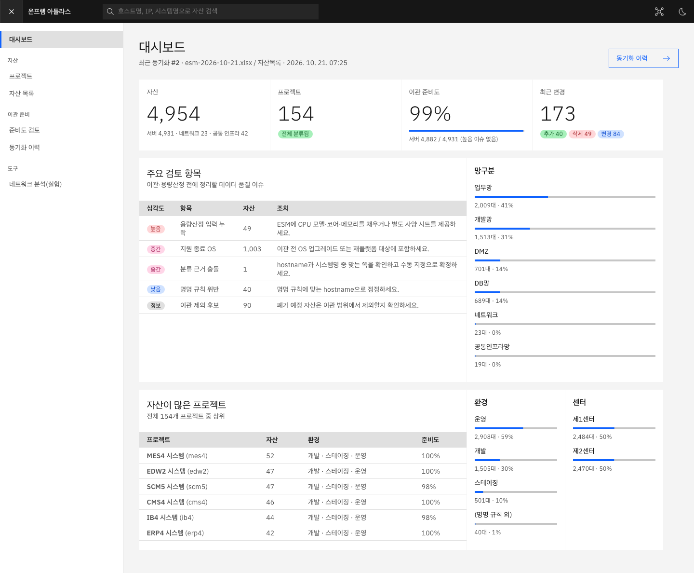

# onprem-atlas

ESM 자산관리 엑셀(xlsx)을 SQLite에 동기화하고, 그 DB를 기준으로 **프로젝트 단위 온프렘 구성도(draw.io)** 와
**AWS 마이그레이션 용량산정 입력**을 만드는 Python 키트입니다. 회사 시스템에 모듈 단위로 떼어 이식하는 것을 전제로 합니다.

용량산정 계산·인스턴스 선정, AI 에이전트, AWS 정책 챗봇, AWS 아키텍처 검토는 **포함하지 않습니다**(이식 대상 시스템에 이미 있음).
계획: [`../docs/plans/2026-10-21-onprem-asset-kit.md`](../docs/plans/2026-10-21-onprem-asset-kit.md)

## 현재 범위 (P1·P2·P2.5 + 읽기 API)

| 모듈 | 하는 일 | 의존성 |
|---|---|---|
| `onprem_atlas.ingest` | xlsx 스트리밍 읽기, 제목 행 건너뛰고 헤더 자동 감지, 한글 동의어 매핑 + 매핑 프로파일, 행 검증 | openpyxl |
| `onprem_atlas.store` | SQLite: 동기화 실행 이력, 원본 행 보존, 정규화 자산, 이슈, FTS5 trigram 키워드 검색 | 표준 라이브러리 |
| `onprem_atlas.classify` | 프로젝트 분류: 수동 지정 > 명명 규칙(정규식 이름 그룹) > 시스템명 컬럼(명명 규칙 결과에서 다수결 학습), 공통 인프라 판정 | — |
| `onprem_atlas.review` | 데이터 품질·이관 준비도 규칙 8종, 프로젝트별 준비도(%) | — |
| `onprem_atlas.diff` | 동기화 실행 간 추가·삭제·필드 변경 | — |
| `onprem_atlas.web` | 읽기 전용 API(`/api/summary·projects·assets·review·runs·diff`), `create_router()`로 회사 FastAPI에 장착 | fastapi (선택 `[web]`) |
| `onprem_atlas.synth` | 명명 규칙을 따르는 합성 ESM 엑셀(기본 5,000행, 의도적 오류 포함) + 다음 동기화 시점(drift) | openpyxl |
| `onprem_atlas.cli` | `inspect` · `import` · `runs` · `search` · `issues` · `classify` · `review` · `diff` · `serve` · `synth` | — |

## 실행

```bash
cd kit
uv venv .venv && uv pip install --python .venv/bin/python -e '.[test]'   # 또는 make kit-setup (저장소 루트)
.venv/bin/onprem-atlas synth --out demo/esm.xlsx                          # 합성 5,000행
.venv/bin/onprem-atlas inspect demo/esm.xlsx                              # 헤더 매핑·건수·문제 행 번호만 출력(자산 값 없음)
.venv/bin/onprem-atlas import demo/esm.xlsx --db demo/atlas.db
.venv/bin/onprem-atlas search erp-was --db demo/atlas.db
.venv/bin/onprem-atlas issues --db demo/atlas.db --severity error
```

실제 ESM 파일은 사내 PC에서 `inspect`만 먼저 돌려 매핑을 확인하세요. 출력에는 헤더 이름·건수·행 번호만 있어 공유해도 자산 값이 드러나지 않습니다.
매핑이 틀리면 [`examples/mapping-profile.json`](examples/mapping-profile.json) 형식으로 `--profile`을 지정합니다.

## 콘솔 데모 (합성 5,000건)

```bash
make atlas-demo        # 저장소 루트: 합성 ESM 2회 동기화 → 분류 → API :8770
npm run dev            # 다른 터미널: Carbon 콘솔 http://127.0.0.1:5173 (/api → :8770 프록시)
```



## 분류 프로파일

[`examples/classify-profile.json`](examples/classify-profile.json): `rules`(정규식, `(?P<project>…)` 필수, `env`·`role`·`site` 선택), `shared_codes`(공통 인프라 코드),
`project_names`(코드 → 표시 이름), `manual`(hostname → 코드), `env_names`. 없으면 합성 데이터 규칙 `<센터2><환경1>-<업무코드>-<역할><순번2>`.

## 표준 필드

`hostname`(키, 대소문자 무시) · `ip` · `asset_tag` · `serial` · `category` · `manufacturer` · `model` · `os` · `cpu_model` · `cpu_sockets` · `cpu_cores` ·
`memory_gb` · `site` · `rack` · `zone` · `system_name` · `owner` · `status`

- 메모리: `64`, `64GB`, `65536MB`, `1TB` → GB. 단위 없는 16384 초과 값은 MB로 보고 `MEMORY_UNIT_ASSUMED_MB` 경고.
- CPU 코어: `32`, `2x16` → 정수. IP 여러 개는 첫 번째를 대표로 쓰고 `MULTIPLE_IP` 경고.
- 이슈 코드(바꾸지 않음): `HOSTNAME_COLUMN_NOT_FOUND`, `PROFILE_COLUMN_NOT_FOUND`, `MISSING_HOSTNAME`, `DUPLICATE_HOSTNAME`(오류) /
  `MISSING_IP`, `INVALID_IP`, `MULTIPLE_IP`, `DUPLICATE_IP`, `INVALID_NUMBER`, `INVALID_MEMORY`, `MEMORY_UNIT_ASSUMED_MB`(경고).

## SQLite 스키마 (v1)

`sync_runs`(실행: 파일 SHA-256·시트·헤더·매핑·프로파일·건수) · `asset_rows`(원본 행 JSON) · `run_assets`(실행별 정규화 자산) ·
`asset_issues` · `classify_runs`·`asset_projects`·`project_names`(분류) · `assets`(뷰: 최신 실행) · `assets_fts`(FTS5 trigram, 최신 실행). 동기화는 실행 단위로 쌓여 실행 간 비교가 가능합니다.

## 이식

- `ingest`는 openpyxl만, `store`는 표준 라이브러리만 씁니다. 웹·에이전트 프레임워크를 import하지 않습니다.
- 테스트: `make kit`(저장소 루트) — ruff + pytest, 합성 데이터만.
